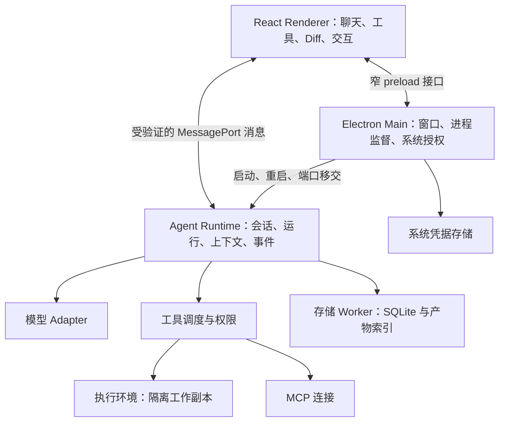

# 桌面 Coding Agent 整体架构设计

状态：架构提案，尚未实现或通过运行验证。日期：2026-10-31。

## 1. 产品范围与建议

按“本地优先、个人开发者、桌面Coding Agent”设计：选项目、读代码、修改文件、执行验证命令、展示工具过程、停止任务、恢复会话和审阅变更。主技术栈为TypeScript、React、Electron、Node.js、SQLite。第一版覆盖macOS的一条完整业务链；Windows/Linux是后续平台验收项，不能因Electron支持跨平台便宣称所有工具已兼容。

先用模块化本地后端，不部署账号、计费、协作等云端业务。模型API仍可远程调用。本提案不把ZCode包里的私有协议原样复制为新产品公共协议，也不把逆向观察视为对方架构的全面验收。

## 2. 进程与信任关系



这里是三个业务进程角色，Electron实际还会创建GPU等内部进程。存储Worker属于Runtime内部实现，执行环境可能再包含容器和子进程，不承诺“系统只有三个OS进程”。

**Renderer**只维护UI投影，不直接访问文件系统、数据库、模型密钥或任意进程启动。主窗口只加载打包的本地资源；远端网页或生成HTML需要独立受限展示环境。preload不暴露通用invoke、shell或fs接口。采用contextIsolation、sandbox及禁用nodeIntegration，并验证IPC发送者与消息schema。[Electron安全指南](https://www.electronjs.org/docs/latest/tutorial/security)

**Main**只持有桌面能力：窗口、文件选择、原生对话框、更新、凭据存储、Runtime生命周期监督。它不运行Agent循环，不成为每个token的业务加工节点。Renderer与Runtime的专用MessagePort由Main授权和移交，Runtime重启时重新建链。

**Runtime**是受信任的应用程序，不运行模型生成的任意JS。它拥有会话状态、Run状态机、调度、模型适配、权限决策和工具执行记录。第三方脚本/MCP启动不在Runtime进程中执行。Electron utilityProcess能提供Node子进程和MessagePort；显式构造env允许列表，避免其默认继承process.env。[utilityProcess官方文档](https://www.electronjs.org/docs/latest/api/utility-process)

进程分离用于故障和生命周期管理，不能当作宿主机安全隔离。第一版一个Runtime管理多个会话，存在共同崩溃影响范围；先监测它，再决定是否按工作区拆进程，不为每个聊天窗口创建一个引擎。

## 3. 后端Module及Interface

| Module | 对外Interface | 内部职责 |
|---|---|---|
| Application | execute(command)、subscribe(cursor)、getSnapshot(scope) | 命令校验、接纳、路由、事件订阅；不另包一层无行为转发 |
| Session Coordinator | 接纳输入、排队、停止、回复交互 | 单会话串行运行；同工作区写操作协调；状态迁移 |
| Agent Runtime | 执行Run并产出类型化变化 | 模型—工具循环、上下文预算、取消、终止判断 |
| Model Gateway | 按选定模型发起流式请求 | Provider Adapter、超时、取消、usage、可重试错误分类 |
| Tool Executor | 执行经过验证的ToolCall | 权限、输入校验、资源预算、执行记录、输出截断与产物存储 |
| Workspace | 获取文件、生成变更集、审阅应用 | 工作副本、路径身份、基础版本、冲突检测 |
| Persistence | 事务提交状态/事件/命令记录 | SQLite、迁移、索引、恢复、归档；单写入所有者 |
| UI Projection | 将确认状态形成snapshot/delta | 文本与工具显示、历史窗口、恢复；AG-UI Adapter在这里 |

这些Module不全部拆成npm包。只有确实跨进程共享或存在不同Adapter的部分才建立独立Interface；Provider、执行环境和传输是真实变化点，普通业务方法无需套统一插件框架。

## 4. 领域身份与运行状态

术语以[CONTEXT.md](CONTEXT.md)为准：Project→Workspace→Session→Run→ModelStep/ToolCall。

- 一个Project可以有原始工作区及多个隔离副本。
- 一个Workspace可以有多个Session；第一版每Session最多一个活跃Run，新输入排队。
- 同工作区允许不同会话并行读取；写操作需要工作区级协调。所有写入前重验基础内容，不能只靠读时的检查。
- 第一版不支持运行中任意改写历史或复杂guide语义；停止后继续、输入排队先闭环。

Run状态建议：`queued → running ↔ waiting_user → completed / failed / cancelled / interrupted`。stop请求先把活跃Run标为cancelling中间状态，再传播取消，确认活动结束或明确超时后生成终态。进程崩溃恢复为interrupted，不自动假装继续执行。

ToolCall状态建议：`arguments_streaming → ready → awaiting_approval? → executing → succeeded / failed / cancelled / unknown`。unknown保留给崩溃后无法确认的副作用；参数结束与执行结束是两件事。

将“运行终态”与“命令接纳ACK”分开：sendMessage accepted之后，模型仍可能失败。

## 5. Agent主流程

1. 运行时验证命令schema、身份、工作区授权、输入大小和模型配置。
2. 在事务中记录commandId、接纳结果及Run；UI拿到ACK后可显示已接纳输入。
3. Coordinator调度Run；Context Builder选择消息、文件引用、工具定义和token预算。
4. Model Gateway发起流式请求，标准化文本、工具参数及usage。
5. 工具参数完整后进行schema与权限校验；第一版等待模型步骤完成，再调度工具，不提前做流中工具执行。
6. 必要时创建Interaction并等待用户。获准后在选定执行环境执行，保存结果/错误，再反馈模型。
7. 循环直到模型结束、用户取消、预算耗尽或不可恢复失败。
8. 事务提交最终状态、完整消息和事件；产出变更集/文件引用。

对同一ModelStep内的工具，初期默认串行。只有证明无副作用且互不依赖的读取才能并行；不只相信模型或MCP描述自称readOnly。请求设置上下文、输出、最大步骤、总时长、工具时间和模型费用预算，超出时有明确终止原因。

## 6. 前后端协议

### 6.1 第一版传输

MessagePort直接发送结构化可克隆的对象，schema验证后消费。暂不自研二进制RPC和base64分片。保持消息有界、分页历史，大产物按引用读取；当测得传输瓶颈时再增加压缩/分片。

设计以下三类消息，不做一个混杂的万能event：

```typescript
Command = {
  protocolVersion: 1;
  requestId: string; commandId: string;
  workspaceId: string; sessionId?: string;
  type: string; payload: unknown; expectedRevision?: number;
}
Ack = {
  commandId: string;
  status: 'accepted' | 'rejected' | 'duplicate' | 'conflict' | 'failed';
  result?: unknown; error?: { code: string; message: string; retryable: boolean };
}
EventBatch = {
  protocolVersion: 1;
  subscriptionId: string; sessionId: string;
  epoch: string; fromSeq: number; toSeq: number;
  events: DomainEvent[];
}
```

这是Interface草图，实施时为每个type建立独立运行时schema、判别联合与消息大小上限，不能把payload:unknown一路透传到工具。

初始命令只保留createSession、sendMessage、cancelRun、resolveInteraction、subscribe、resync、loadHistory和审阅/应用变更等必要能力。subscribe/resync/readHistory属于查询控制，不必全部使用业务命令持久化。

requestId关联一次传输尝试；commandId标识同一用户意图，超时重试保留它。命令去重按已授权工作区/会话及commandId，持久化结果，并比较payload摘要：同ID不同内容直接冲突。createSession也要在其上级作用域去重。

### 6.2 显示与恢复

新订阅先给 `Snapshot{epoch,seq,revision,state}`，然后推送EventBatch。前端要求fromSeq等于当前seq，旧批次可丢弃，跨代或断档请求resync。日志游标保留到磁盘，不因UI重载而丢失；Runtime重启不无条件更换epoch，只有日志语义不连续时更换。

快照和订阅注册必须在同一序列化操作中完成，防止两者之间遗漏事件。先注册订阅、暂存待交付事件，再激活；返回快照水位以后只交付更高序号。日志被裁剪时返回新快照，不无限重放。

同一会话batch中状态变更和文本增量可以不同频率合并。后端提供事实，前端局部乐观显示仅存在于UI overlay，由ACK/event确认，不能提前宣称文件写入成功。

### 6.3 AG-UI位置

本产品的内部执行协议拥有命令、权限、幂等、游标与恢复；AG-UI Adapter将确认的业务变化投影成RUN_STARTED、TEXT_MESSAGE_*、TOOL_CALL_*、STATE_*等。不要让Runtime依赖React组件或某种聊天UI SDK。

首版自用React可以直接消费内部投影；需要对接AG-UI前端时新增一个Adapter。其TOOL_CALL_END只代表调用声明完成；自定义对象patch不直接当RFC6902。基线及源码证据见[此前AG-UI对照](/Users/a1111/Documents/ChatGPT/杂七杂八/zcode-analysis/protocol/agui-reference.md)。

## 7. 执行环境、权限与凭据

### 7.1 建议的安全默认值

工具执行统一入口：`validate → authorize → record intent → execute → persist outcome`。模型、项目说明、网页内容和工具返回值都不能直接授予权限或修改策略。

建议第一版的自动执行在**隔离工作副本**中：项目通过受控导入形成副本，文件工具与shell看到同一份文件。可先实现容器Runner；使用非root用户、不挂宿主目录/凭据/Docker socket、限制CPU/内存/PID/输出/时间，网络默认关闭，按任务需要授权到受控网络。容器管理能力仅留在可信宿主程序，不交给模型或容器内程序。

容器可作为第一种Adapter，但不是所有macOS/原生工程的通用解法。缺少可用隔离环境时，应明确提示能力不可用；不自动退回不受限宿主shell。容器默认没有资源限制，需要显式配置和验证。[Docker资源限制说明](https://docs.docker.com/engine/containers/resource_constraints/)

用户审阅ChangeSet后，Workspace Module比较原始文件基础hash再应用。导入时不跟随逃逸symlink，排除凭据和无需导入的大目录；导出视为不可信文件，禁止逃逸路径、symlink和特殊文件，限制展开大小。跨多文件应用不是天然原子操作：先整体预检，记录应用journal和可恢复备份；失败必须标记partial并支持恢复，不能宣称已原子完成。

若产品定位需要直接改宿主项目，可以增加**显式本地模式**。其文件工具做路径/文件类型/授权校验，shell仍有宿主权限风险，UI必须准确表达执行环境。路径校验或用户批准不等于OS隔离，不作“保护整个宿主机”的承诺。本提案建议隔离工作副本作为默认，具体交互需产品确认。

### 7.2 授权与取消

授权绑定workspace、run、toolCall、输入摘要、能力及有效期。参数修改后重新审批，不允许“批准一次某工具”等价于允许任意新参数。相同调用回复重复提交只结算一次；拒绝、过期、取消分别保留原因。

取消信号覆盖模型请求、待审批、排队工具和已启动执行。对子进程使用受监督的进程组/平台机制与实际资源句柄；TERM后超时KILL，核对清理结果。仅记录PID不够证明拥有某个进程。应用退出默认取消任务，后台常驻属于后续独立能力。

### 7.3 凭据

Provider密钥由系统凭据存储管理，Main提供窄的凭据访问Interface。可信Runtime在模型请求需要时获取，保留范围和寿命最小化，不转发到renderer、shell环境、日志或工作副本。数据库保存credentialRef，不保存明文key。MCP确需的凭据逐连接独立授权，第三方MCP也必须服从执行环境策略。

## 8. 数据与恢复

第一版一个应用数据库，由Runtime内的存储Worker独占写入；业务模块不跨越它直接连库。SQLite同步接口不能放在UI或关键事件循环上；实际Node API选择以打包的Electron内嵌Node版本为准，不能直接按最新独立Node文档开发。[Node SQLite文档](https://nodejs.org/api/sqlite.html)

建议的表：workspaces、sessions、runs、messages/message_parts、tool_calls、interactions、commands、session_events、artifacts、changesets、schema_migrations。大文件、长工具输出和附件存应用管理的文件区，DB只记录metadata、大小、hash和引用。

- 当前状态与需发布事件在同一事务提交；提交后才推送。事务范围不包含网络调用。
- 文本按时间/字节批量落盘，终态必须flush；建议初始50–100ms/批、单批上限16KiB作为调优起点，不是已测性能保证。
- command accepted前持久化接纳；工具启动前记录intent；执行后记录outcome。
- DB恢复时把执行中的Run标为interrupted。ToolCall若已启动但无结果，标unknown，先核对文件/进程/外部结果，再决定是否重试。
- 数据迁移带版本/校验及失败恢复；数据库只在正常启动后对外接纳新Run。磁盘满时停止接纳副作用，保留错误与待核对状态。

文件/DB事务与外部工具副作用不能组成一个全局事务，故不承诺exactly-once。与状态恢复分开的是执行恢复：前端重新显示历史不会再次调用模型或执行工具。

## 9. 性能、成本与可观测性

- 初期全局同时运行2个Run、同会话1个，仅作为可配置起点；实际限制由模型配额、机器资源和Runner容量共同决定。
- 文本显示批量刷新、历史分页、列表虚拟化；不能每个token重建整段历史。
- 慢消费者使用有界缓冲；满时断开并发最新snapshot恢复，不阻塞所有会话，也不无限积压。
- 大输出截断展示并保留受限artifact引用；保留策略按空间预算清理，正在引用的文件不删除。
- 模型请求记录usage与预算。缺失usage时标记估算，模型切换后重新核对上下文预算；不将估算费用当账单。
- 第一版不做每回合全仓embedding或自动长期记忆，先用文件工具、文本检索及明确引用；避免额外模型与索引成本。
- 索引/解析等CPU重任务进worker或Runner；Node异步I/O不能消除同步计算阻塞。

日志与指标按workspaceId/sessionId/runId/modelStepId/toolCallId关联。记录TTFT、步骤耗时、模型重试、工具错误、审批等待、IPC积压、DB延迟、Runtime/Runner内存与退出原因。默认不记录密钥、完整提示词和源代码正文；诊断导出需要明确内容范围。

启动/执行错误返回稳定code、可读message、retryable及定位ID。重试只针对可判定安全的操作；模型已经产生副作用工具时，不能从Run起点盲目重跑。

## 10. 目录建议

```text
apps/
  desktop/
    main/                  桌面壳、进程监督、系统能力
    preload/               窄桥接
    renderer/              React视图与投影store
  runtime/
    src/
      application/         命令入口与会话Coordinator
      agent/               Run状态机、Context、ModelStep循环
      models/              Provider适配
      tools/               权限与工具调度
      workspace/           工作副本、Diff、应用变更
      persistence/         SQLite与存储Worker
      projections/         自用UI与AG-UI Adapter
      execution/           Runner生命周期与连接
packages/
  protocol/                跨进程schema、DTO、版本协商
```

起步只需要desktop、runtime、protocol三个工作区包。业务模块位于runtime内部，既不建一个无所不包的shared包，也不为每个类建独立package。打包选择与Electron/原生依赖一起验证，锁定版本；不要依赖用户机器装了哪版Node。

## 11. 实施顺序和验收

| 阶段 | 交付纵向链路 | 必须验证 |
|---|---|---|
| 1 | 打开项目→读文件→单Provider回答→流式显示→保存会话 | 错误可见、取消有效、重启可读历史、凭据不进入前端 |
| 2 | 生成修改→隔离执行验证命令→展示Diff→审阅应用 | 原目录不被自动写、逃逸输入拒绝、原文件冲突阻止应用 |
| 3 | 命令ACK→订阅恢复→Runtime崩溃与工具未知状态 | 重连不丢/重加文本、不重复执行副作用、清理可核对 |
| 4 | 多会话→工作区写协调→受控MCP | 并发有界、权限不可被工具输出改变、慢消费者可恢复 |
| 5 | 按真实需求加入AG-UI外部接入、远端Runner、子Agent | 版本协商、运行身份与取消语义一致 |

以上是手动/集成验收场景建议，不是已执行结果，也不生成单元测试。第一版先把这几条链路做可靠，再增加Computer Use、动态插件、定时任务、账号和云同步。涉及原生桌面控制时另设授权与执行Module，不把它混入普通项目文件权限。

## 12. 仍需产品选择的事项

本轮采用的默认假设是个人、本地优先、macOS先行、隔离工作副本执行。是否把宿主目录直接编辑设为默认、是否一开始支持Windows、是否有团队账号与远程执行，尚未确认，会改变Runner与部署设计。其余职责、身份、协议和恢复规则不依赖具体UI风格，可以据此继续形成实现规格。
